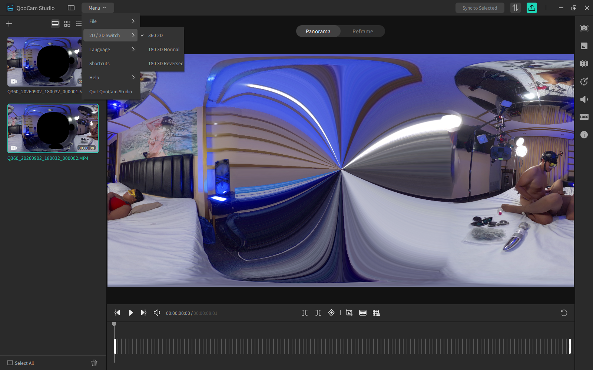
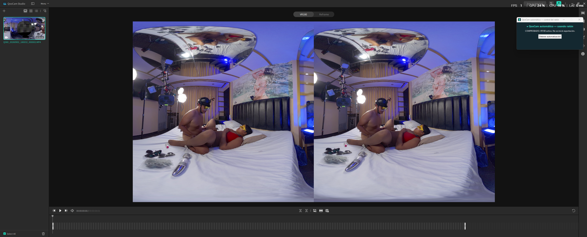
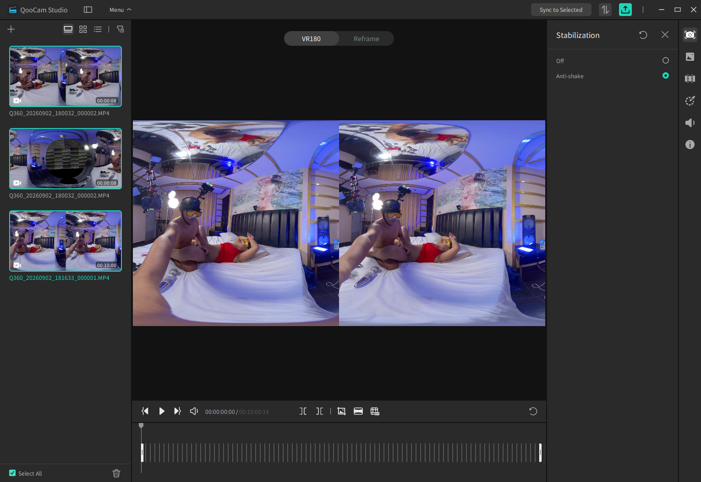
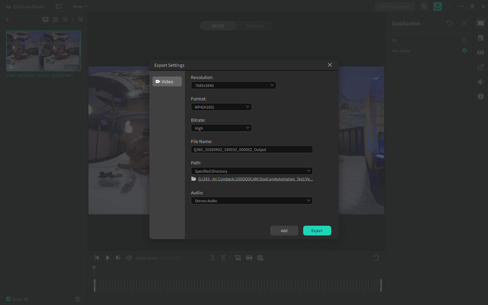
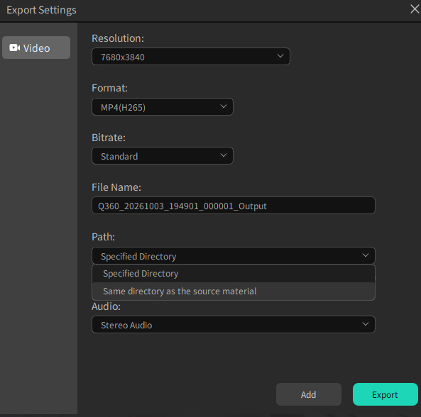
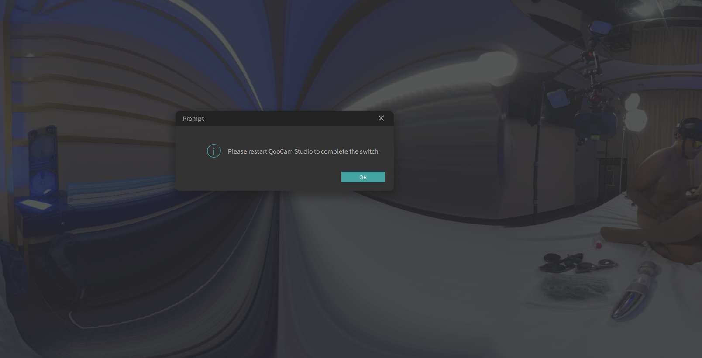
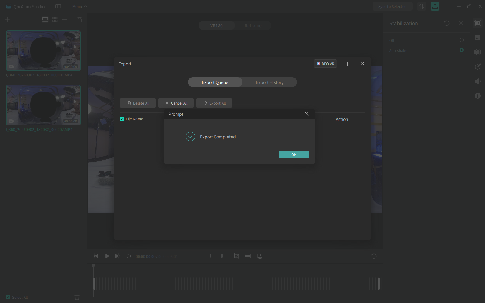

# QooCam: ajustes verificados y evidencia visual

Evidencia obtenida durante pruebas reales del ejecutable entre el 27 y el 29 de septiembre de 2026. La version integrada conserva estos ajustes fijos y bloquea la exportacion si alguno no queda confirmado.

| Ajuste | Valor obligatorio | Verificacion |
|---|---|---|
| Importacion | `Single Import` | Cada MP4 queda como elemento independiente; nunca Merge. |
| Modo 3D | `180 3D Normal` | Seleccion por nombre exacto; nunca Reverse/Reversed. |
| Visor | `VR180` | Debe aparecer antes de continuar. |
| Estabilizacion | `Anti-shake` | Se aplica y vuelve a comprobar clip por clip. |
| Resolucion | `7680x3840` | Se vuelve a leer antes de Export. |
| Formato | `MP4(H265)` | Se vuelve a leer antes de Export. |
| Bitrate | `High` | Se vuelve a leer antes de Export. |
| Audio | `Stereo Audio` | Se vuelve a leer antes de Export. |
| Salida | `Specified Directory` | Apunta a `100QOOCAM\KDOutput`. |

## 1. Modo 180 3D Normal

La opcion objetivo es **180 3D Normal**, no `180 3D Reversed`.

## 2. VR180 activo

Despues del reinicio y de reabrir el proyecto, el programa exige que el visor muestre **VR180**.

## 3. Anti-Shake aplicado

El panel `Stabilization` muestra **Anti-shake** seleccionado. Los videos aparecen separados a la izquierda. El automatizador realiza y confirma este paso individualmente para cada video.

## 4. Ajustes de calidad comprobados anteriormente

La captura confirma `7680x3840`, `MP4(H265)`, bitrate `High`, `Stereo Audio` y `Specified Directory`. El directorio seleccionado debe ser exactamente la subcarpeta `KDOutput` de la entrada.

## 5. Ruta correcta: KDOutput

La opción obligatoria es **Specified Directory**, seleccionando `100QOOCAM\KDOutput`. Aunque la captura siguiente muestre la alternativa `Same directory as the source material` y bitrate `Standard`, solamente sirve para identificar el desplegable; el automatizador elige `Specified Directory` y vuelve a comprobar `High` antes de exportar.

## 6. Aviso de reinicio

Al elegir `180 3D Normal`, QooCam puede pedir reiniciar la aplicación. El programa pulsa `OK`, vuelve a `File > Home` y abre el proyecto más reciente.

## 7. Variacion Feedback / Send

En algunas computadoras QooCam se cierra durante la configuración y al abrirse presenta la ventana `Feedback`. El procedimiento obligatorio es:

1. Encontrar exactamente la casilla `Send error report`.
2. Dejarla **desmarcada**.
3. Confirmar por automatización que su estado es desmarcado.
4. Guardar una captura de referencia local.
5. Pulsar `Send` y volver a abrir QooCam.
6. Recuperar el proyecto ya creado y continuar desde el paso pendiente.

Si la otra computadora usa textos o controles diferentes, el automatizador se detiene sin enviar el reporte. La captura generada se guarda como `04-feedback-send-report-desmarcado.png` en `%LOCALAPPDATA%\QooCamBatchAntiShake\screenshots` y sirve para adaptar esa instalación.

## 8. Exportacion completada

El ejecutable termino la prueba y QooCam mostro `Export Completed`.

## Comprobacion de los MP4 resultantes

- Prueba individual y prueba de dos videos ejecutadas por el `.exe`, sin sustituir sus pasos por clics manuales.
- Codigo de salida `0`.
- Tres MP4 decodificados completamente sin errores.
- HEVC/H.265, `7680x3840`, audio estereo y aproximadamente `211.5 Mbps`.
- Stereo 3D side-by-side, `inverted=0`, con proyeccion esferica.
- El manifiesto registro `180 3D Normal`, `Single Import`, `Anti-shake` y bitrate `High`.

## Protecciones

- Si Anti-Shake no persiste en cualquier clip, la exportacion se bloquea.
- Si los videos verificados no coinciden con los seleccionados, la exportacion se bloquea.
- Antes de pulsar Export se vuelven a leer resolucion, formato, bitrate, ruta y audio.
- Los renders ya verificados no se repiten.
- Una salida heredada solo se adopta si `ffprobe` confirma HEVC 7680x3840, duracion valida y audio estereo.
